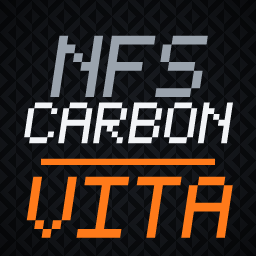

<a id="readme-top"></a>

<div align="center">



<h3 align="center">NFSCVita</h3>

<p align="center">
  <b>Need for Speed Carbon, on the PS Vita</b>
  <br />
  <br />
  A fan port of the PC version of Need for Speed Carbon (2006, version 1.4)
  <br />
  <br />
  <a href="#install">Install</a>
  &nbsp;·&nbsp;
  <a href="#controls">Controls</a>
  &nbsp;·&nbsp;
  <a href="#settings">Settings</a>
  &nbsp;·&nbsp;
  <a href="#known-issues">Known issues</a>
  &nbsp;·&nbsp;
  <a href="../../issues">Report a bug</a>
</p>

</div>

> **Version 0.1.3, early pre-release.** Races, free roam and the career start (through the prologue into the free roam) work, but the game runs at about
> 20 fps (target: 30) and there are known issues. Expect bugs; save often.

> **Vibe-coded.** This port was written almost entirely by an AI coding assistant
> ([Claude Code](https://claude.com/claude-code)), directed and play-tested on a real Vita by the maintainer. Changes
> are tested on hardware and logged in [docs/STATUS.md](docs/STATUS.md), but expect rough edges in the code.

This is not a decompilation or a rewrite of the game. The code of your own `NFSC.exe` is translated to C++ ahead of
time (static recompilation) and runs on the Vita with replacements for what the Vita lacks: Windows, Direct3D 9
(drawn with sceGxm), DirectSound, DirectInput and the Visual C++ 7.1 runtime. The gameplay itself (physics, AI,
career, saves) is the game's own.

**No game files are included.** You need your own copy of the PC game. The VPK contains the port's runtime and the
code recompiled from the game's executable, but none of its data: the game reads that from your copy on the memory
card.

## Requirements

- Need for Speed Carbon for PC, **version 1.4**, installed (your own copy). The port is built against one exact
  `NFSC.exe` (unwrapped, 7,217,152 bytes, SHA-256
  `baaaaec33873d4ba7e4dbae6a5212049ffdcf9679a35d865d7625b4189952fd3`), the same one the
  [Mac](https://github.com/vasist15-source/nfs-carbon-mac) and
  [Android](https://github.com/codepdbh/nfscarbonpc-androidevolved) ports require. The game checks it at start and
  closes with a message in the log if it differs.
- PS Vita with HENkaku / Ensō and [VitaShell](https://github.com/TheOfficialFloW/VitaShell)
- About 5.5 GB free on the memory card (about 4.5 GB without the `MOVIES` folder, which the port skips)
- [CapUnlocker](https://github.com/GrapheneCt/CapUnlocker) is strongly recommended: it lets the port use the
  Vita's fourth CPU core.
- [PSVshell](https://github.com/Electry/PSVshell) is strongly recommended: set the CPU to 500 MHz (the speeds below
  were measured at 500). The
  port sets the bus and GPU clocks itself but leaves the CPU clock to you (see `cpu_clock` under
  [Settings](#settings)).

## Install

1. Download `NFSCVita.vpk` from the [Releases](../../releases) page (or [build it yourself](#build)) and install it
   with VitaShell.
2. On your PC, open the game folder (the one with `NFSC.exe`) and copy **everything inside it** to
   `ux0:data/NFSCVITA/` (VitaShell's FTP or USB mode works). `NFSC.exe` must end up at `ux0:data/NFSCVITA/NFSC.exe`.
   The `MOVIES` folder can be left out.
3. **Highly recommended:** install [CapUnlocker](https://github.com/GrapheneCt/CapUnlocker) (follow its
   instructions). It lets the port use the Vita's fourth CPU core; the speeds in this README were measured with it.
4. Start the game from the home screen.

If the game closes right away, `ux0:data/NFSCVITA/nfscvita.log` says why (most often: a missing file or a different
`NFSC.exe`).

The first start takes a while (shaders and the profile are set up). Saves go to `ux0:data/NFSCVITA/save/`.

## Controls

The default layout follows [NFSUG2_VITA](https://github.com/danos-x5/NFSUG2_VITA). It can be changed on the game's
Controls screen; a changed layout is kept and saved with the profile.

### Driving

| Button | Action |
|--------|--------|
| R | Gas |
| L | Brake / reverse |
| Left stick | Steer |
| Cross | Handbrake |
| Circle | Nitrous |
| Triangle / Square | Shift up / down |
| D-pad down | Speedbreaker |
| D-pad left | Crew |
| D-pad up | Engage event |
| Rear touch, lower left | Look back |
| Rear touch, lower right | Change camera |
| Select | Reset car |
| Start | Pause |

### Menus

| Button | Action |
|--------|--------|
| D-pad / left stick | Move |
| Cross | Select |
| Circle | Back |
| L / R, Square / Triangle | The menu's extra functions |
| Start | Start |

## Settings

Settings go in `ux0:data/NFSCVITA/nfscvita.cfg`, one `name=value` per line (create the file if it does not exist).
Lines starting with `#` are comments.

| Setting | Values | Effect |
|---------|--------|--------|
| `cpu_clock` | `0` (default), `333`, `444`, `500` | `0` leaves the CPU clock to PSVshell; the others set it at start |
| `gfx_detail` | `low` (default), `medium`, `high` | The game's Level of Detail preset (higher is slower) |
| `scenery_scale` | `0.5` (default) to `1` | Small or distant scenery is skipped earlier below `1` (the game's own value); faster |
| `car_reflections` | `on` (default), `off` | The car environment pass; off is faster but cars look flat in dark streets |
| `frame_rate` | `30` (default), `60` | Frame cap |
| `skip_movies` | `on` (default), `off` | Movies are slow and grey in this version, so they are skipped |
| `audio_max_rate` | `24000` (default), up to `48000` | Mixing rate; higher sounds better and costs speed |
| `rear_touch` | `on` (default), `off` | Rear touch inputs (look back, camera) |
| `ug2_layout` | `on` (default), `off` | The Vita button layout above, or the game's generic controller layout |
| `use_core3` | `on` (default), `off` | Use the fourth core when CapUnlocker opens it |
| `stream_track_kb` | `46000` (default) | Size of the track streaming pool in KB; larger can crash at the career start |
| `console_log` | `off` (default), `on` | Also print the log to a debug console |

## Known issues

- About 20 fps in races and free roam at 500 MHz with CapUnlocker (the CPU is the limit; see [docs/STATUS.md](docs/STATUS.md) for the work on
  it).
- Movies are skipped: the game's VP6 decoder is too slow on the Vita in this version.
- Memory is tight: Carbon's PC streaming pools are larger than the Vita's memory. The pools are shrunk, which can
  make the world fill in late after a fast move into a new area. Report crashes with the log, please.
- Only the career start (prologue into the first free roam), races and free roam have been tested so far; later
  parts of the career are untested.
- No online play.
- Only the one version 1.4 `NFSC.exe` above is supported.

When reporting a bug, attach `ux0:data/NFSCVITA/nfscvita.log` (and any `ux0:data/psp2core-*.psp2dmp` crash dump).

## Build

Requirements: Windows 10 or later, [Python 3](https://www.python.org/downloads/), PowerShell (part of Windows), about
10 GB of free RAM (swap counts) and about 15 GB of disk space. Everything else is downloaded on the first build:
[VitaSDK](https://vitasdk.org) and [LLVM](https://llvm.org) into `.deps/`, CMake, Ninja and Capstone with pip.

```powershell
powershell -NoProfile -ExecutionPolicy Bypass -File tools\build.ps1 -Game "<folder with NFSC.exe>"
```

The result is `build-release-clang/NFSCVita.vpk`. The first build translates `NFSC.exe` and the audio banks
(`SOUND/**/*.abk`) into C++ (`src/nfsc/generated/`, about an hour) and compiles it; later builds only rebuild what
changed. The build options are described at the top of `tools/build.ps1`.

- The recompiled code is generated from your own `NFSC.exe`; no game code or data is in this repository.
- The VPK on the Releases page has the game's logo and art on its icon and LiveArea. The images in this repository
  are plain ones (the game's name as text); to make the logo ones from your game files, run
  `python -I tools/vita/livearea_art.py "<game folder>"` before building (into `sce_sys/game/`, which the build
  prefers and git ignores), or add `--vpk NFSCVita.vpk` to put them into a built VPK.
- Shaders ship prebuilt in `shaders/gxp/` (compiled on a Vita with `tools/shadercomp.ps1`).
- Testing over Wi-Fi: `tools/vita.ps1` uploads a build to a Vita running
  [vitacompanion](https://github.com/devnoname120/vitacompanion) and fetches the log (set `$env:VITA_IP`, for example
  in `tools/env.local.ps1`).

| Path | Contents |
|------|----------|
| `include/` | virtual x86 CPU, runtime, Win32 and platform headers |
| `src/lib/` | runtime: guest memory, threads, Win32, C runtime, Direct3D 9 and D3DX, DirectSound |
| `src/platform/` | Vita backend: GXM renderer, audio, input, sync, logging, profiler |
| `src/nfsc/` | Carbon: entry point, controls, audio thread, audio bank code, native replacements of game functions |
| `src/nfsu/` | UG1VITA's Underground code, kept for reference; not built |
| `shaders/` | Cg shaders and compiled binaries |
| `tools/recompiler/` | the static recompiler (x86 to C++) and the audio bank translator |
| `tools/` | build, test and profiling scripts |
| `docs/` | development log ([STATUS.md](docs/STATUS.md)), notes on imports, testing and the other ports |

## Credits

- [NDRWhun](https://github.com/NDRWhun): [UG1VITA](https://github.com/NDRWhun/UG1VITA), the Need for Speed
  Underground Vita port this one is built on (runtime, recompiler, renderer)
- [danos-x5](https://github.com/danos-x5): [NFSUG2_VITA](https://github.com/danos-x5/NFSUG2_VITA) (control layout,
  on-Vita shader compiler, sampling profiler, LiveArea art script, many ideas)
- [vasist15-source](https://github.com/vasist15-source): [nfs-carbon-mac](https://github.com/vasist15-source/nfs-carbon-mac)
  (Carbon addresses and data layouts: effects, controls, movies, widescreen)
- [ThirteenAG](https://github.com/ThirteenAG): [WidescreenFixesPack](https://github.com/ThirteenAG/WidescreenFixesPack)
  (NFSCarbon.WidescreenFix, MIT: the widescreen values)
- [codepdbh](https://github.com/codepdbh): [nfscarbonpc-androidevolved](https://github.com/codepdbh/nfscarbonpc-androidevolved)
  (Carbon notes)
- [Grarak](https://github.com/Grarak): [psp2-tooling](https://github.com/Grarak/psp2-tooling) and
  [mh3-wii](https://github.com/Grarak/mh3-wii)
- [GrapheneCt](https://github.com/GrapheneCt): CapUnlocker
- EA Black Box: *Need for Speed Carbon*

## License

MIT for the port's own code ([LICENSE](LICENSE)); third-party parts: [THIRD_PARTY.md](THIRD_PARTY.md).

Unofficial, non-commercial fan port, not affiliated with or endorsed by Electronic Arts. *Need for Speed* and
*Carbon* are trademarks of Electronic Arts Inc. You must own the game.
